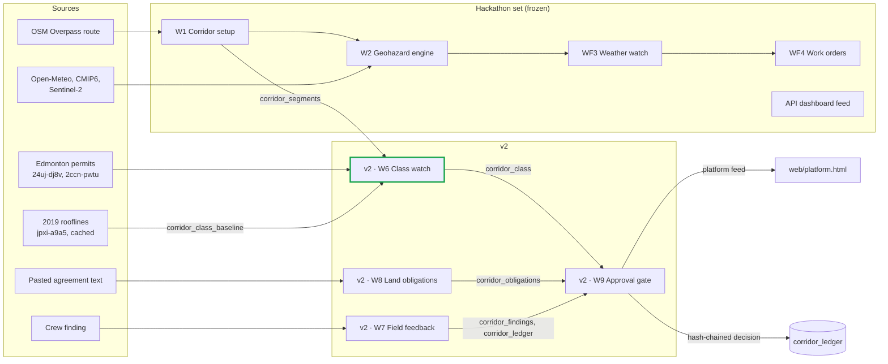

# n8n v2 workflows: setup and handoff

Last updated Nov 17, 2026. Instance: `chlooood.app.n8n.cloud` (Cloud Pro). Read this before touching n8n.

## Ground rules

- **The hackathon workflows stay as they are.** Anything without `v2 ·` in its name (W1, W2, WF3, WF4, W5, API feed, Email, seeds, showcase) is frozen. Do not edit, publish or unpublish it.
- **Every new workflow is a v2 workflow.** Name it `v2 · <id> - <name>`, give it the `v2` tag, and leave it unpublished until it has run once by hand.
- **v2 webhooks live under `terracorridor-v2/`**, never `terracorridor/`. The hackathon set already owns `terracorridor/*`, and two workflows can't share a path.
- **The repo is the source of truth.** Change the generator in `scripts/` or the export in `workflows/`, re-import, and commit the export to `workflows/v2/`. Don't hand-edit logic in n8n.
- **Every v2 workflow starts with a sticky note** called "About this workflow" that covers what it does, the trigger, what it reads and writes, and what comes next. `workflows/v2/v2 · W6 - Class location watch.json` is the model to copy.
- **Fail closed.** Missing or bad data becomes `unverified`, never `safe` or `no change`.

## What exists now

| Workflow | State | Trigger | Reads | Writes |
| --- | --- | --- | --- | --- |
| v2 · W6 Class location watch | **Built and verified, Nov 17** | Mondays 06:00, manual | corridor_segments, corridor_class_baseline, Edmonton permits (24uj-dj8v, 2ccn-pwtu) | corridor_class |
| v2 · W9 Approval gate and evidence | To build (task A) | POST `/terracorridor-v2/decide`, GET `/terracorridor-v2/platform` | corridor_class, corridor_obligations, corridor_findings, corridor_ledger | corridor_ledger |
| v2 · W8 Land obligations | To build (task B) | Manual, POST `/terracorridor-v2/obligation-check` | corridor_obligations, corridor_segments | corridor_obligations |
| v2 · W7 Field feedback | To build (task C) | POST `/terracorridor-v2/finding` | corridor_ledger | corridor_findings, corridor_ledger |
| v2 copies of WF4 and the API feed | To build (task D) | as the originals | as the originals | as the originals |

W6 result on the Edmonton demo line: 23 segments assessed, all `verified`. 22 show no change. km 5.8 to 7.4 is `change_possible`, Class 1 now and Class 2 possible, which matches docs/PLATFORM.md. n8n Cloud reaches data.edmonton.ca fine. No operator has checked the result, and the class rules follow US 49 CFR 192.5 until someone reads CSA Z662.

## How they connect

## Sources and why each one is used

| Source | Used by | Purpose | Status and limits |
| --- | --- | --- | --- |
| City of Edmonton building permits (`24uj-dj8v`) | W6 | Homes that are committed but not built yet: the early signal satellites can't see | Real, pulled live by n8n Cloud on every run |
| City of Edmonton development permits (`2ccn-pwtu`) | W6 | An even earlier signal: approved projects that have no building permit yet | Real, live, since 2024 |
| City of Edmonton rooflines 2019 (`jpxi-a9a5`) | W6, via corridor_class_baseline | The starting count of homes per 200 m bin, which permits are added to | Real but one survey date only. Cached in the repo, loaded as a table |
| OSM Overpass pipeline route | W1, then W6 through corridor_segments | Cuts the line into 1 km segments that every workflow keys on | Real public way. Not proof of the operator or the exact route |
| Open-Meteo, CMIP6, Sentinel-2, Copernicus DEM | W2, WF3 | Geohazard score that adds context to a class decision | Real. Open-Meteo blocks n8n Cloud's IP, so W2 uses a cache |
| Pasted agreement or CER commitments table | W8 | Promises (notice, timing, access) that can rule a response in or out | No real agreement yet. Rows are kept only with a word-for-word quote |
| Crew findings | W7 | What crews actually saw, paired with what was predicted | No crew has used it yet |
| Class rules: 49 CFR 192.5 thresholds, CER 6-month clock | W6 | Turns home counts into a class and a filing deadline | US thresholds stand in until CSA Z662 is read |
| Gemini (n8n credential) | W2, WF4, W8 | Explains or extracts text only. Never decides a class, a deadline or a cost | Fails open to a template |

## Data tables (already created, shared by all v2 workflows)

| Table | ID | Filled by |
| --- | --- | --- |
| corridor_class | `FXVk5TLLPkkXEUHS` | W6 |
| corridor_class_baseline | `n1aDLVEitzHWHhxh` | Loaded from `data/tables/corridor_class_baseline.csv` (62 bins, 2019 rooflines) |
| corridor_obligations | `EUZF5nhieoE8ARzj` | W8 |
| corridor_findings | `dVuau6onaUzgJ6Yr` | W7 |
| corridor_ledger | `q6mDVRiZld0fztmn` | W7, W9 |

Hackathon tables (corridor_segments and the rest) are read-only for v2 work. All IDs are in `workflows/wiring.json`.

## Setup (once per person)

1. Pull `main` once this branch is merged.
2. Run `npm install`, then `npm test`. All tests must pass.
3. Sign in to `chlooood.app.n8n.cloud`. You should see `v2 · W6 - Class location watch` with the `v2` tag.
4. The W7, W8 and W9 exports in `workflows/` already carry the v2 table IDs (generated by `npm run platform-workflows` and wired by `node scripts/wire-workflows.js`). Run `node scripts/validate-workflows.js --strict`; it must say `no errors`.
5. If you use Claude, give it the prompt for your task below. Claude needs the built-in browser or Claude in Chrome signed in to n8n.

## Tasks

Each task is done when: the workflow is in n8n with the v2 name, tag, `terracorridor-v2/` paths and an "About this workflow" note; it has run once with a result you checked; and its export is committed to `workflows/v2/` in a pull request.

**Task A. v2 · W9 Approval gate and evidence.** Owner: Teammate 3 (backend). Import `TerraCorridor W9 - Approval gate and evidence.json`, rename it, and move both webhooks to `terracorridor-v2/`. Test it: POST a decision with a name (expect 200 and a ledger row), one with no name (expect 400), and a rejection with no reason (expect 400). Then GET `/platform` and check that W6's km 5.8 to 7.4 row comes back. Publish only after those pass.

> Prompt: *Read docs/N8N_V2.md in github.com/katiescase/terracorridor. Do task A in our n8n at chlooood.app.n8n.cloud, following the ground rules. Show me the test results before publishing.*

**Task B. v2 · W8 Land obligations.** Owner: Teammate 4. Import `TerraCorridor W8 - Land obligations.json`, rename it, and move the webhook to `terracorridor-v2/obligation-check`. It uses the existing Gemini credential. For the manual extraction, paste the CER commitments table Teammate 1 extracts (sprint board, Nov 19). Only rows with a word-for-word quote get saved, and they stay `unverified`. Then POST one work order to the check webhook and confirm it lists the promises on that kilometre.

> Prompt: *Read docs/N8N_V2.md in github.com/katiescase/terracorridor. Do task B in our n8n at chlooood.app.n8n.cloud, following the ground rules. Show me the test results before publishing.*

**Task C. v2 · W7 Field feedback.** Owner: Teammate 3, after task A. Import `TerraCorridor W7 - Field feedback.json`, rename it, and move the webhook to `terracorridor-v2/finding`. POST one valid finding (expect a findings row and a ledger row chained to W9's last hash) and one bad finding (expect 400).

> Prompt: *Read docs/N8N_V2.md in github.com/katiescase/terracorridor. Do task C in our n8n at chlooood.app.n8n.cloud, following the ground rules. Show me the test results before publishing.*

**Task D. v2 copies of WF4 and the API feed.** Owner: Teammate 4, after task B. Duplicate the repo exports, not the live originals: the repo API feed is newer (it adds Coquihalla sources). Rename both, move the webhooks to `terracorridor-v2/action` and `terracorridor-v2/corridor`, and add the note. Then wire W8 into the WF4 copy so every drafted order lists the obligations on its kilometres (06_Technical_Master, "Land promises before work").

> Prompt: *Read docs/N8N_V2.md in github.com/katiescase/terracorridor. Do task D in our n8n at chlooood.app.n8n.cloud, following the ground rules. Show me the test results before publishing.*

**Not now:** v2 copies of W1, W2, WF3 and Email. The originals already feed corridor_segments and the geohazard tables, and the strategy treats them as supporting. W10 referral intake and W11 filing clock wait until interviews show the chore is real (docs/STRATEGY_STAGE1.md).

## Gotchas

- Open-Meteo blocks n8n Cloud's shared IP (HTTP 429). This doesn't affect v2 W6 to W9.
- If W6 has no baseline rows, it still runs but marks segments `lower_bound`. Reload `corridor_class_baseline.csv` if the table is ever emptied.
- n8n "archive" is reversible. Archived v2 drafts from Nov 17 (W1, W2, WF3, WF4, API, Email, W7, W8, W9) are in the archive. Restore one instead of re-importing if it saves time, then check it against this doc.
